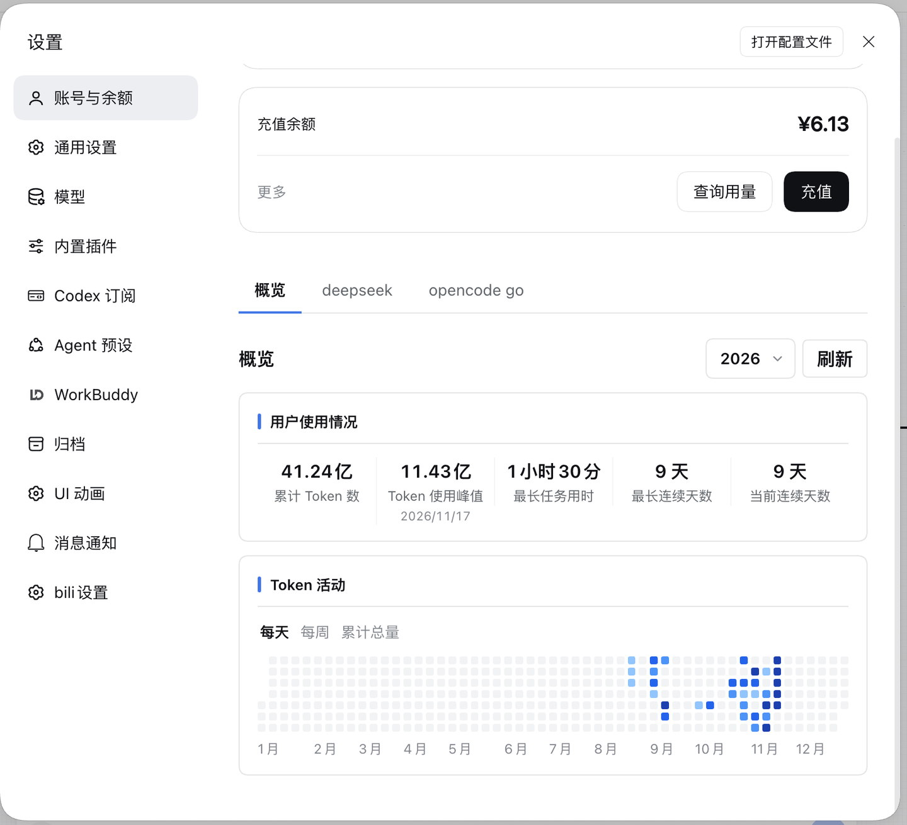
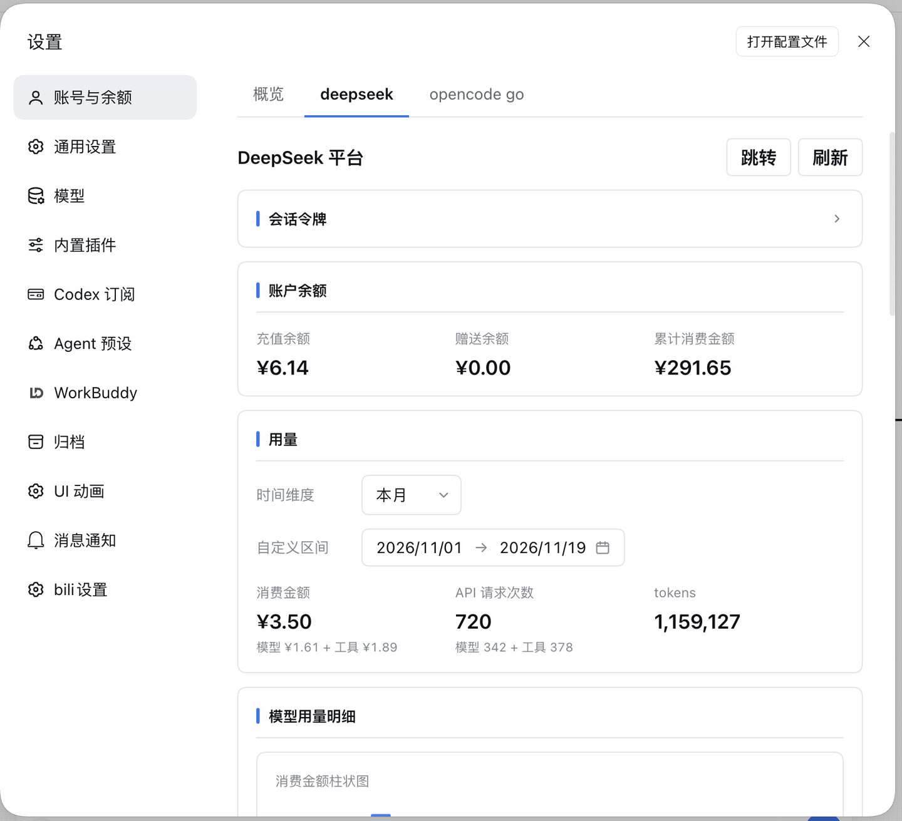
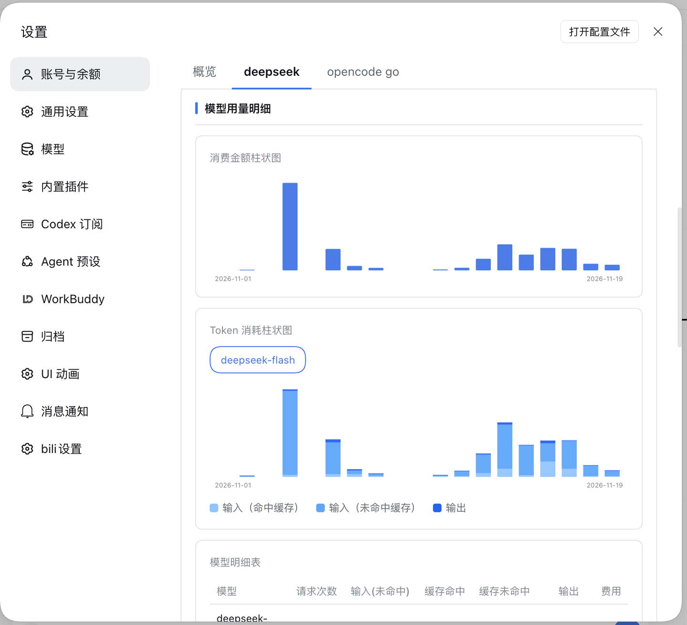
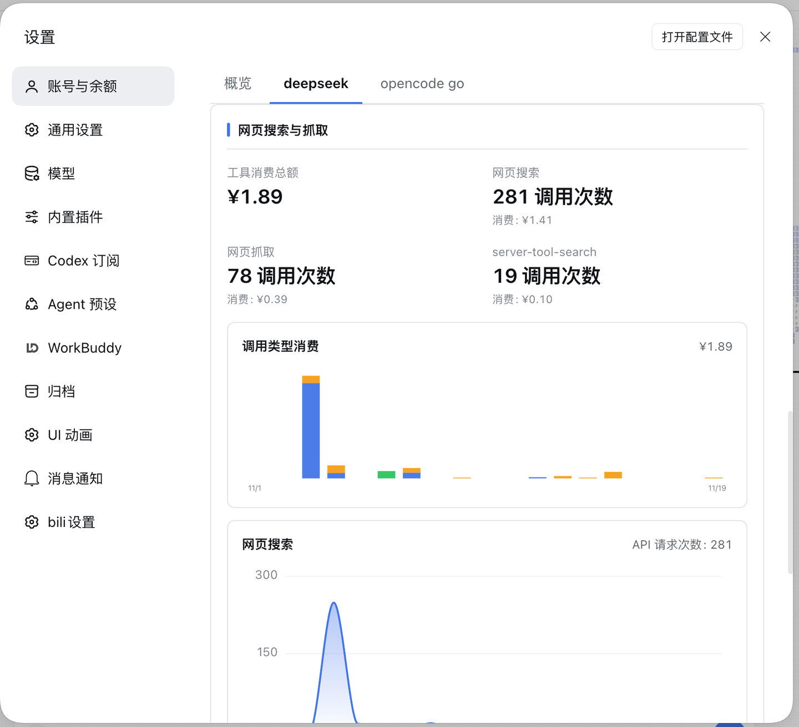
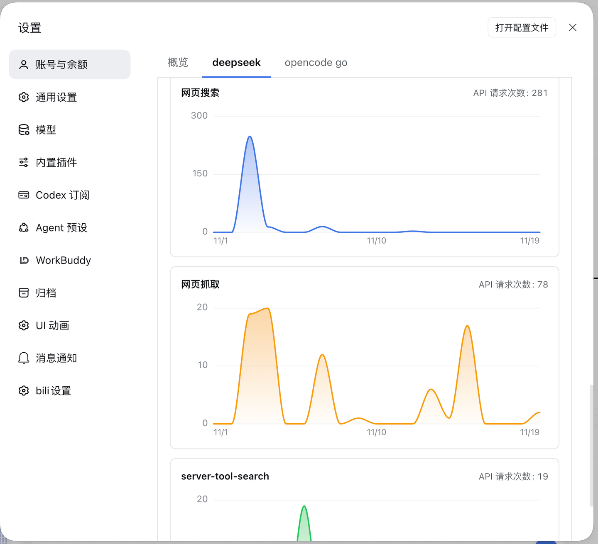
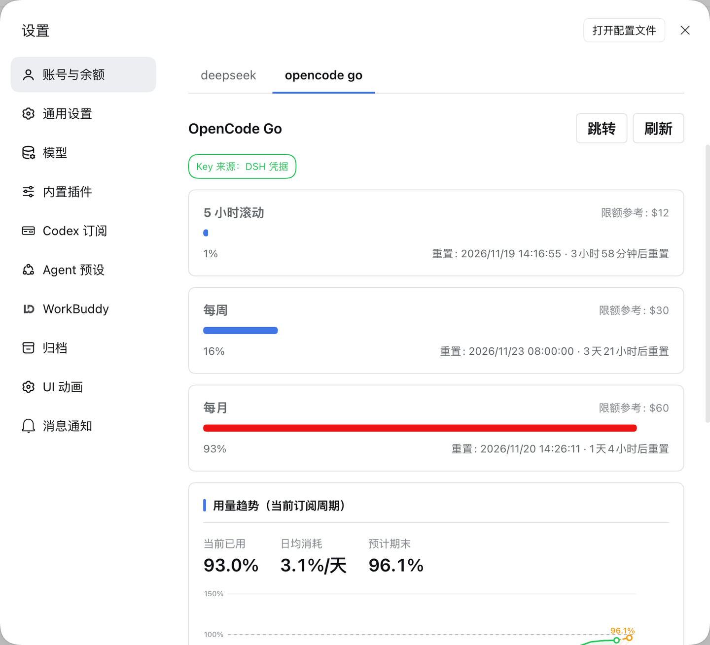
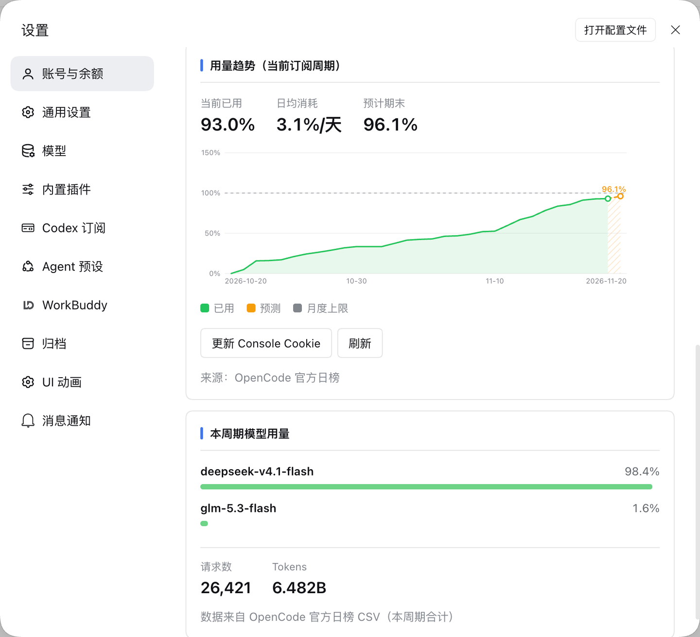
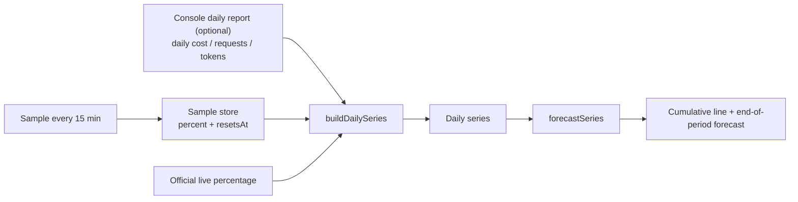

# dsh-account-usage

[](README.md)
[](README_en.md)

<div align="center">

A DeepSeek Harness (DSH) web-GUI plugin: adds an "Account" page to the settings panel for a one-stop view of DeepSeek platform balance/usage, OpenCode Go quotas, and the current subscription period's quota-consumption trend with an end-of-period forecast.

> npm package: `@ycet/dsh-account-usage`. The unscoped [`dsh-account-usage`](https://www.npmjs.com/package/dsh-account-usage) on npm is an unrelated project by another author — do not mix the two.

[](LICENSE)
[](package.json)
[](https://www.npmjs.com/package/@ycet/dsh-account-usage)
[](https://github.com/deepseek-ai/deepseek-harness)

</div>

---

## 📑 Table of Contents

- [📸 Preview](#-preview)
  - [Overview](#overview) · [DeepSeek platform](#deepseek-platform) · [OpenCode Go](#opencode-go) · [What each tab shows](#what-each-tab-shows)
- [✨ Features](#-features)
  - [Overview capabilities](#overview-capabilities) · [DeepSeek platform capabilities](#deepseek-platform-capabilities) · [OpenCode Go capabilities](#opencode-go-capabilities) · [General capabilities](#general-capabilities)
- [🚀 Quick Start](#-quick-start)
- [⚙️ Configuration](#️-configuration)
- [📖 Usage](#-usage)
- [🔧 How It Works](#-how-it-works)
- [🧰 Environment Variables](#-environment-variables)
- [⚠️ Known Limitations](#️-known-limitations)
- [🛠️ Development](#️-development)
- [🤝 Contributing](#-contributing)
- [📄 License](#-license)

---

## 📸 Preview

The plugin embeds into the official "Account & balance" page and is split into three tabs: **Overview / deepseek / opencode go**. All screenshots below are taken from the real running UI.

### Overview

The default tab: eight usage stats in two rows (total / this month / this week / today tokens, plus peak day, longest task, longest streak and current streak), the yearly token activity heatmap, and a monthly trend chart (Jan–Dec tokens and active sessions on twin axes).



### DeepSeek platform

Session token, account balance, usage totals (model + tools), model usage details, and web search/fetch usage.









### OpenCode Go

Quota progress bars and reset times for the three windows, plus the current period's usage trend and extrapolated forecast.





### What each tab shows

| Tab | Main content | Data source |
|-----|--------------|-------------|
| **Overview** | Eight usage stats in two rows, the yearly token activity heatmap (daily / weekly / cumulative, Monday-first) and a monthly trend chart (tokens + active sessions) | Local session logs (scanned and cached by the host) |
| **deepseek** | Session token, account balance, usage totals, model usage details, web search & fetch | Private endpoints of the DeepSeek platform |
| **opencode go** | Quota window progress, usage trend and forecast, models used this period | Official OpenCode usage endpoint + optional Console cookie |

---

## ✨ Features

### Overview capabilities

| Feature | Description |
|---------|-------------|
| **Usage stats (two rows, eight items)** | Row 1: total tokens (follows the year dropdown), this month / this week (Monday-first) / today tokens (always the real current date). Row 2: peak day (with date), longest task, longest streak, current streak (follow the year dropdown) |
| **Active sessions** | The daily / weekly count of sessions that consumed tokens (subagents included); weekly counts are de-duplicated per session. Shown as the third tooltip line on the heatmap; the `Cumulative` mode keeps its original two lines |
| **Monthly trend chart** | Follows the year dropdown: Jan–Dec tokens (left axis, area + line) and **de-duplicated monthly** active sessions (right axis, line + dots), with all twelve months labelled. Future months break off, and an empty axis is kept when there is no data |
| **Append-only ledger** | Stats come from local session logs; archived or deleted sessions still keep and contribute their historical usage |
| **Token activity heatmap** | Year grid laid out in two rows (Jan–Jul / Aug–Dec) of ~16px rounded cells, with `Daily` / `Weekly` / `Cumulative` modes |
| **Monday-first weeks + bottom-up fill** | One column is one week, with **Monday as the first day** (top = Monday, bottom = Sunday); weekly and cumulative both fill each column from the bottom, so the number of colored cells equals the days used that week, one shade per column |
| **Fixed daily buckets + adaptive weekly/cumulative** | The `Daily` mode uses fixed decimal bounds (1M / 10M / 100M / 500M — six levels in total) so colours never drift with the year's data; `Weekly` and `Cumulative` still bucket dynamically on a log scale (P25/P50/P75). Only 0-token days stay empty and any cell with usage gets at least the first level |
| **Colour ramp and legend** | 0-token days are neutral grey and active days deepen across five blue levels (level 5 marks the ≥500M extremes; it never appears in weekly/cumulative modes); a six-swatch “Less → More” legend sits under the grid, switching to a dark base with a dim-to-bright ramp in dark theme |
| **Hover detail** | Shows the date / week / cumulative caption plus the token count with unit (万/亿 in Chinese, K/M/B in English); daily and weekly modes add a third `N active sessions` line |

### DeepSeek platform capabilities

| Feature | Description |
|---------|-------------|
| **Account overview** | Recharge balance, bonus balance, cumulative spending, current-month spending and tokens |
| **Time-range switching** | Today / last 7 days / last 30 days / this month / last month / custom range |
| **Range cap up front** | Custom ranges are limited to 3 calendar months right inside the calendar: out-of-range days are disabled with a hover reason, so the old “clipped to the most recent months” notice never appears |
| **Range calendar** | Open-platform-style two-month calendar: Sunday-first, dark circular endpoints, per-day light range fill, today marker, future dates disabled, single month on narrow screens, full keyboard support; applies as soon as both ends are picked or the calendar closes |
| **Usage card (model + tools)** | "Spend" and "API requests" combine model usage with web search/fetch usage, with a small breakdown line ("model ¥x + tools ¥x"); degraded honestly when the tool endpoint is unavailable |
| **Model usage details card** | Cost and token bar charts (SVG, hover for per-day detail) plus the per-model table, all on the model-only basis |
| **Three-shade token chart** | The token chart stacks input (cache hit) / input (cache miss) / output in three shades of blue, and the tooltip lists the daily total plus the three rows |
| **Web search / fetch usage** | The stats area starts with the total tool cost, then daily call counts and cost by call type (`tool-search` / `tool-fetch`) with per-tool area charts; ranges over 31 days are queried in windows and merged |

### OpenCode Go capabilities

| Feature | Description |
|---------|-------------|
| **Quota windows** | Usage percentage and next reset time for the 5-hour rolling / weekly / monthly windows |
| **Quota trend & forecast** | Per-day cumulative quota line for the current subscription period plus a linear forecast to the reset date; hover shows date, cumulative used, that day's increment and that day's requests; gaps are labelled, never interpolated |
| **Models this period (cookie only)** | With an OpenCode Console cookie: the period's most-used models with shares, total requests and total tokens (from the official daily report) |

### General capabilities

| Feature | Description |
|---------|-------------|
| **Merge into the official Account & balance page** | When the official page exists, plugin content is embedded below its native cards and no separate nav entry is added; switching sections hides it and switching back restores it |
| **Fallback standalone page** | When DSH is signed out or the official account page does not exist, the plugin registers its own "Account" section so the token and usage stay reachable |
| **Account-menu balance entry** | Shows "Balance: ¥x.xx" (top-up + granted) above "Settings" in the account menu; click to open the official Account & balance page **straight on the DeepSeek tab**, falling back to the plugin's own page (same DeepSeek landing) when the official one is unavailable |
| **Sticky tabs** | The tab bar sticks to the top of the settings content area while scrolling |
| **Auto refresh** | Polls for fresh data every 60 seconds while the page is mounted |
| **Bilingual UI** | Full Chinese/English switching |

> [!NOTE]
> `0.6.2` unifies the DeepSeek balance display: the balance card on the Account page and the account-menu entry now read the balance snapshot from DSH's official account service (the same source as the official Settings → Account & balance page) and format it with the official **truncation** rule (4.589 → ¥4.58, not the rounded ¥4.59). If the official service is unavailable, the plugin falls back to its own platform-session data but keeps the same truncation rule. The "Limit (ref.): $12/$30/$60" text is removed from the three opencode go quota cards. **Both host and client changed** — a local `link` install needs a full quit and reopen of DSH plus a page refresh.

> [!NOTE]
> `0.6.1` fixes the "Models this period" card on the opencode go tab: the official daily CSV exported by OpenCode Console is a **rolling 30-day window**, so right after a subscription period resets it still contains the tail of the previous period — the model shares, request count and tokens shown were from the old period. The host now clips the CSV to "current period start → today (no later than period end)" before rolling up the models and totals, matching the usage-trend chart above; the card is hidden when the current period has no usage yet. **Host-side only** — even a local `link` install needs a full quit and reopen of DSH (refreshing the page is not enough).

> [!NOTE]
> `0.6.0` adds three things to the Overview tab. First, the **stats card now has two rows of four**: row 1 is total tokens (follows the year dropdown) plus this month / this week (Monday-first) / today tokens (these three always use the real current date and do not change when you switch to a past year), while row 2 keeps the original peak day, longest task, longest streak and current streak. Second, the **heatmap tooltip gains a third line, "N active sessions"**, counting sessions that consumed tokens that day (subagents included); the `Weekly` mode de-duplicates per session so one session active on several days counts once, and the `Cumulative` mode keeps its original two lines. Third, a new **Monthly trend card sits below the heatmap**: it follows the year dropdown and plots Jan–Dec tokens (left axis, area + line) against active sessions (right axis, line + dots), breaking off at future months, showing the month plus both values on hover, and keeping an empty axis when there is no data. The session counts are computed by the host while aggregating the ledger (counted directly per day, de-duplicated by session id per week/month), so **the ledger format is unchanged and no rescan is needed** — open the Overview tab after upgrading. On an older host without these fields the third line and the right axis hide themselves. Local reads only; no new network calls.

> [!NOTE]
> `0.5.2` fixes the Overview token accounting: **a subagent session replays its parent's entire history into its own log, and that replay was being counted a second time**, inflating daily usage noticeably (on this machine 2026-11-17 showed 1.14B instead of 404.6M — about 92% too high for the day, and roughly 33.7% too high overall). Folding a session's events now recognises the `session/end-seed` event (`data.inherited === true`) and skips every replayed event before it, so the numbers match the real consumption in the DSH session log. The ledger format is bumped to version 2 and old entries are recomputed on the next scan; history from sessions whose logs are already gone is preserved as-is. Open the Overview tab and hit refresh once (or wait for the first automatic scan) to see corrected figures.

> [!NOTE]
> `0.5.1` moves the "at most 3 calendar months" cap **into the calendar itself**: once one end is picked, days beyond the limit are greyed out and unclickable with a hover reason, and the host-side "Range exceeds the per-query month cap; clipped to the most recent months" notice is gone. The "last 90 days" preset is removed (it spans 4 calendar months on 338 of 365 days); Today / last 7 days / last 30 days / this month / last month remain. The account-menu "Balance: ¥x.xx" entry now opens the Account & balance page **straight on the DeepSeek tab** (entering from the settings gear or nav still defaults to Overview). Client-side only: host routes and credentials are unchanged, so reinstall with the command above and refresh the page (a local `link` install only needs a refresh).

> [!NOTE]
> `0.5.0` replaces the native date inputs with an **open-platform-style two-month range calendar** (Sunday-first, dark circular endpoints, per-day light range fill, light circle for today / white dot when today is an endpoint, future dates disabled, single month on narrow screens, arrow-key + Enter/Esc support) and splits the DeepSeek page into three cards — Usage, Model usage details, and Web search & fetch. The Usage card now reports spend and API requests as **model + tools totals** with a breakdown line, the model table moved into Model usage details, the tool card gained a total tool cost stat, the tab bar sticks to the top while scrolling, a new leftmost default **Overview** tab adds five per-year usage stats plus a yearly token heatmap (from local session logs; the ledger only grows, so archived or deleted sessions still count), the token chart uses a three-step blue ramp for input (cache hit) / input (cache miss) / output with a "date + daily total" tooltip header plus three detail rows, and the preset dropdown is now custom-skinned (the native `<select>` border occasionally failed to repaint after switching options). Client-side only: host routes and credentials are unchanged, so reinstall with the command above and refresh the page (a local `link` install only needs a refresh).

> [!NOTE]
> `0.4.1` publishes to npm under the scoped name **`@ycet/dsh-account-usage`** (the unscoped `dsh-account-usage` is taken by another project). The `cordis.patch.yml` loader entry name and the client module id follow the package name, and the manifest now carries `repository` / `homepage` / `bugs` / `publishConfig`. If you installed an older copy under the previous name, run `dsh plugin --profile web remove dsh-account-usage` first, then install with the command above and fully quit and reopen DSH.

> [!NOTE]
> `0.4.0` adds a "Usage trend (current period)" card below the three quota cards in the opencode go tab: the host samples the official quota percentage every 15 minutes and persists it (`~/.dsh/storages/dsh-account-usage/opencode-samples.v1.json`, kept for 180 days), which drives the per-day cumulative line and a linear forecast (`used% ÷ elapsed days × remaining days`). An optional OpenCode Console cookie unlocks the official daily report (daily requests, per-model shares, 0.1% precision); the chart works without it. **Note**: local sampling only accumulates from the day the plugin starts recording, so right after installing the current period only holds post-install data — configure the Console cookie for the full period. Fully quit and reopen DSH desktop after upgrading.

> [!NOTE]
> `0.3.0` merges the plugin content into the official "Account & balance" page: when that page exists, no separate "Account" nav entry is shown and the content appears below the native cards; embedded mode keeps the full "top-up / granted / cumulative spend" balance display alongside the official balance card (the two may refresh at slightly different times). The account-menu balance entry now opens the official page. The standalone fallback page remains for signed-out users / older DSH. Fully quit and reopen DSH desktop after upgrading.

> `0.2.0` adds web search/fetch usage charts and an account-menu balance entry. The entry targets the native account menu structure of DSH desktop `0.2.1-rc.5`: on older versions without that menu, or if upstream redesigns it, the entry stays hidden without affecting the Account page. The tool-usage API is limited to 31 days per request; the plugin splits and merges longer ranges automatically. Fully quit and reopen DSH desktop after upgrading.

---

## 🚀 Quick Start

### Prerequisites

- DSH CLI and pnpm installed (`dsh plugin` forwards to pnpm internally)

### Install

```sh
# Option 1: install from npm (recommended; can be updated from the plugin page)
dsh plugin --profile web add @ycet/dsh-account-usage@0.6.2

# Option 2: install from a local source directory (development)
dsh plugin --profile web add <absolute-path-to-plugin>

# Option 3: install from GitHub (pinned to a release tag; requires git, no npm account)
dsh plugin --profile web add "github:Ycet/dsh-account-usage#v0.6.2"

# Option 4: install from a Release asset (tarball; no git, no npm account)
dsh plugin --profile web add "https://github.com/Ycet/dsh-account-usage/releases/download/v0.6.2/dsh-account-usage-0.6.2.tgz"
```

The package declares a `dsh.bundle` patch layer; `dsh plugin` merges the loader entry into the profile's bundle layer automatically — no manual editing of `cordis.patch.yml` required. Options 2–4 need no npm account; for the desktop app replace `--profile web` with `--profile desktop` (using the desktop-bundled CLI).

> Copies installed from npm can be updated from "Plugins → Installed"; copies installed from a GitHub tag or a Release tarball cannot be updated in place — uninstall and reinstall instead.

<details>
<summary>Manual patch-layer merge (optional)</summary>

```yaml
# ~/.dsh/profiles/web/cordis.patch.yml
- insert:
    - id: account-usage
      name: '@ycet/dsh-account-usage'
```
</details>

### Launch

1. Restart the web app: `dsh web`
2. Open http://127.0.0.1:3080 and refresh the page
3. After signing in to a DSH official account, open "Settings → Account & balance"; the plugin content appears below the native cards. When signed out, the plugin's fallback "Account" page appears instead

---

## ⚙️ Configuration

### DeepSeek platform token (required; only affects the DeepSeek tab)

The usage endpoints are private APIs of the platform console and need your login token:

1. Sign in at https://platform.deepseek.com
2. Open DevTools → Console and run:

   ```js
   JSON.parse(localStorage.getItem('userToken')).value
   ```

3. Paste the token into the input on the plugin's "Account" page and save it (stored as `DEEPSEEK_PLATFORM_TOKEN` in `~/.dsh/.credentials.yaml`)

<details>
<summary>Write the credentials file manually (optional)</summary>

```yaml
# ~/.dsh/.credentials.yaml
DEEPSEEK_PLATFORM_TOKEN: <token>
```
</details>

The token stays in your local credential store; the browser and network requests never carry it anywhere beyond the upstream.

### OpenCode Go key (usually no configuration needed)

The plugin looks it up automatically in this order:

1. DSH credential `OPENCODE_GO_API_KEY` (`~/.dsh/.credentials.yaml`; usually already present when opencode-go is configured in Settings → Models);
2. OpenCode's own `~/.local/share/opencode/auth.json` (the `opencode-go` entry with `type: api`).

### OpenCode Console cookie (optional; only affects the official daily report in the usage trend)

The public `GET /zen/go/v1/usage` endpoint returns only the current three windows' percentages and **no history at all**; the Console daily report (daily requests, per-model shares, 0.1%-precision percentages) only accepts a browser session. To let the trend chart cover the whole period and show daily requests, configure the Console cookie once:

1. Sign in at https://opencode.ai/console in a browser;
2. Open DevTools → Network, reload the page and pick any request to `console/api/...`;
3. Copy the `cookie` request-header value (e.g. `session=...; other=...`);
4. In the plugin's "Usage trend" card click "Configure Console cookie", paste it and save (stored as `OPENCODE_CONSOLE_COOKIE` in the DSH credential store).

Security contract: the cookie is read only inside the DSH host process and is used only for three fixed whitelisted URLs (`/console/api/go/status`, `/console/api/activity/go`, `/console/api/v2/usage/export`). It never appears in the browser UI, logs, or any response body; diagnostics expose only status codes and the CSV header row. When the session expires the card says so — paste a fresh value, or use "Clear" at any time.

It is optional: without it the trend falls back to local sampling (labelled "local sampling").

---

## 📖 Usage

### Opening it

- Open the official "Account & balance" page in settings; the plugin content appears below the native identity/balance cards. When signed out, the plugin's standalone "Account" page is shown instead;
- Switch between the **Overview / deepseek / opencode go** tabs at the top of the embedded plugin content (Overview is the default);
- The account menu (sidebar account avatar) gets a "Balance: ¥x.xx" entry above "Settings" (top-up + granted balance); clicking it opens Settings on the official "Account & balance" page and **lands directly on the DeepSeek tab** (or the fallback page, also on the DeepSeek tab, when the official one is unavailable). Entering the account page from the settings gear or the nav still defaults to Overview;
- Data auto-refreshes every 60 seconds while the page is mounted; "Open config file" locates your local DSH credentials file.

### On the Overview tab

- The year dropdown drives total tokens, the second row of stats, the heatmap and the monthly trend chart; this month / this week / today tokens always use the real current date and ignore the dropdown;
- The heatmap is laid out by calendar year with **Monday as the first day of each week** (top = Monday, bottom = Sunday); to keep the cells large enough, the year is split into **two rows (Jan–Jul / Aug–Dec)**; three modes are available:
  - `Daily` — shades by that day's usage;
  - `Weekly` — one shade per column, filled bottom-up with as many cells as days used that week;
  - `Cumulative` — shaded by the running total at that week's last day, with the same bottom-up fill and future dates left empty;
- Hovering a day or week shows the date (or week), the token count and "N active sessions"; the `Cumulative` mode keeps only the first two lines;
- The Monthly trend chart under the heatmap follows the year dropdown and plots Jan–Dec with all twelve months labelled: a blue line with a light-blue area for tokens (left axis) and an orange line with dots for **de-duplicated monthly** active sessions (right axis — one session active on several days of a month counts once); future months break off, and hovering shows the month plus both values;
- Four levels are bucketed on a log scale (P25/P50/P75 boundaries) so only 0-token days remain empty;
- The host scans local session logs in the background on first visit (shows "Scanning…") and the numbers refresh automatically when it finishes; the refresh button forces a rescan.

### On the DeepSeek tab

- Pick a time range (Today / last 7 days / last 30 days / this month / last month), or open the read-only range box and pick start/end in the open-platform-style two-month calendar — **picking both ends closes the calendar and applies the range**, and closing it by Esc or an outside click also applies whatever range is staged (an unfinished single-end pick is discarded); hovering previews the range after the first click;
- A custom range spans **at most 3 calendar months**: once one end is picked, days beyond that cap are greyed out and unclickable, and hovering explains why;
- The Usage card's spend and API requests are the model + tools (web search/fetch) total, with a small breakdown line;
- Hover over the bar charts for daily details; the token chart stacks input (cache hit) / input (cache miss) / output; the per-model table shows requests, tokens and cost for the selected range;
- The "Web Search & Fetch" module starts with the total tool cost, then shows daily `tool-search` / `tool-fetch` call counts, call-type cost and per-tool area charts for the selected range; ranges over 31 days are split and merged automatically.

### On the OpenCode Go tab

- View usage percentage and next reset time for each quota window, with one-click "Go to opencode.ai" and "Refresh" buttons;
- Below the three quota cards, "Usage trend (current period)" uses the current subscription period as its x-axis (derived by stepping one calendar month back from the monthly reset time): the green line is cumulative quota used, the dashed amber line is the forecast to the reset date, and the dashed grey line is the 100% limit; hover any day for date / used / that day / requests;
- The summary row shows current used, daily pace and the projected end value; when the period just started (under one day) it says "Period just started" and makes no forecast;
- With a Console cookie configured, a "Models this period" card (model shares, requests, tokens) appears below the trend card.

---

## 🔧 How It Works

A dual-half plugin (host + browser) with data flowing through same-origin HTTP routes registered by the host:

| Part | File | Role |
|------|------|------|
| Host | `index.js` | Registers five precise `GET /api/account-usage/*` routes (`deepseek-summary` / `deepseek-usage` / `opencode` / `opencode-history` / `insights`); resolves keys via `ctx.credentials`, uses fixed allow-listed upstream URLs, 15s timeout + 30s cache; `deepseek-usage` merges model usage with web search/fetch usage; a 15-minute background sampler writes the local sample store |
| Parsing/aggregation | `lib/aggregate.js` | Pure functions: daily/per-model token, cost and request-count aggregation; time-window splitting and function-usage merge for web search/fetch; subscription-period derivation, sample compaction, Console CSV/JSON parsing, daily-series building and linear forecasting |
| Usage ledger | `lib/insights.js` | Pure functions: folds `assistant/message.usage` and turn durations out of session logs and merges them into the ledger incrementally by revision; sessions missing from the list are marked `retained` and keep counting, so the ledger only grows |
| Browser | `client.js` | Hand-written lazy CJS client bundle: when the official account page exists, mounts its content root below the native cards of its `settings.section` `<section>` using `react-dom/client` (detaches DOM but keeps the root on section switches; unmounts when settings closes); otherwise registers the fallback `settings.section` (id `account-usage`). Also renders the SVG charts, 60s refresh, settings nav icon and account-menu balance entry |
| Composition | `cordis.patch.yml` | `dsh.bundle` patch layer, merged automatically on install |

### Data sources

| Purpose | Endpoint | Auth |
|---------|----------|------|
| Account summary | `platform.deepseek.com/api/v0/users/get_user_summary` (+`/get_user_info`) | `Bearer <userToken>` |
| Daily token details | `platform.deepseek.com/api/v0/usage/amount?month=&year=` | `Bearer <userToken>` |
| Daily cost details | `platform.deepseek.com/api/v0/usage/cost?month=&year=` | `Bearer <userToken>` |
| Web search/fetch call counts | `platform.deepseek.com/api/v0/usage/by_api_key/amount?start=&end=&tz=` (≤31 days per request) | `Bearer <userToken>` |
| Web search/fetch cost | `platform.deepseek.com/api/v0/usage/by_api_key/cost?start=&end=&tz=` (≤31 days per request) | `Bearer <userToken>` |
| OpenCode Go quota | `opencode.ai/zen/go/v1/usage` (official) | `Bearer <sk-opencode-…>` |
| Console Go meters (optional) | `opencode.ai/console/api/go/status` | browser session cookie |
| Console daily activity (optional) | `opencode.ai/console/api/activity/go?range=30d` | browser session cookie |
| Console usage export CSV (optional) | `opencode.ai/console/api/v2/usage/export?range=30d` | browser session cookie |

The Overview tab touches no external endpoint: the host reads local session logs (`ctx.sessionPersistence`), folds them and persists the result to `~/.dsh/storages/dsh-account-usage/usage-ledger.v1.json`.

### How the trend numbers are derived



- **Period**: one calendar month stepped back from the monthly `resetsAt` (reset on 11/20 → period starts 10/20);
- **Sampling mode**: each day's last sample becomes that day's cumulative value; days when DSH was not running stay "not recorded" and the line breaks — no interpolation; today's point is always anchored to the official live percentage;
- **Official daily-report mode**: the daily report's **cumulative cost share** is multiplied by the **official live percentage** (shape from the report, magnitude from the official meter), which avoids the non-linear per-model conversion;
- **Daily increment**: computed only between two adjacent recorded days, left empty across gaps;
- **Forecast**: `pace = used% ÷ elapsed days`, `end = used% + pace × remaining days`; no forecast while the period is under one day old;
- **Privacy**: the sample store holds percentages and timestamps only — no session content, model names or request content.

---

## 🧰 Environment Variables

| Variable | Default | Description |
|----------|---------|-------------|
| `DSH_ACCOUNT_USAGE_TIMEOUT_MS` | `15000` | Upstream request timeout (ms) |
| `DSH_ACCOUNT_USAGE_CACHE_MS` | `30000` | Platform data cache TTL (ms) |
| `DSH_ACCOUNT_USAGE_MAX_MONTHS` | `3` | Max months a single query may span (truncated automatically) |
| `DSH_ACCOUNT_USAGE_OPENCODE_CACHE_MS` | `60000` | OpenCode quota cache TTL (ms) |
| `DSH_ACCOUNT_USAGE_SAMPLE_INTERVAL_MS` | `900000` | Background sampling interval (ms; 15 minutes by default) |
| `DSH_ACCOUNT_USAGE_SAMPLE_FIRST_DELAY_MS` | `30000` | Delay before the first sample after the plugin loads (ms) |
| `DSH_ACCOUNT_USAGE_SAMPLING` | unset | Set to `off` to disable background sampling entirely |
| `DSH_ACCOUNT_USAGE_DATA_DIR` | `~/.dsh/storages/dsh-account-usage` | Sample store directory |
| `DSH_ACCOUNT_USAGE_CONSOLE_CACHE_MS` | `600000` | Console report cache TTL (ms; invalidated immediately when the cookie changes) |

---

## ⚠️ Known Limitations

- The Overview tab relies on DSH's `sessionPersistence` service to read local session logs: on first use (or on a new machine) the ledger is empty until the background scan finishes, and the page shows "Scanning…" meanwhile. The ledger lives at `~/.dsh/storages/dsh-account-usage/usage-ledger.v1.json`; deleting it **loses the historical totals of already-deleted sessions** (their logs are no longer on disk), so clean it up carefully. On older DSH versions without that service the tab reports that session-log statistics are unsupported.
- Sessions started from a worktree and sessions from subagents both count; the longest-task stat only measures main-session turns, not subagent time. The parent history a subagent replays at startup (events before a `session/end-seed` with `data.inherited === true`) is excluded from tokens so it is not billed twice.
- The DeepSeek usage APIs are **undocumented private endpoints**; fields may change as the platform evolves. The plugin parses responses defensively and degrades missing fields to "—" instead of failing. If "—" persists, re-capture the API and report back.
- "Cumulative spending" and "API request count" are not in public docs: cumulative spending is located by a naming heuristic in the summary response (shows "—" if not found), and request count reads `count/requests/request_count/req_count/calls` fields on model entries. Both were calibrated against a real token.
- The web search/fetch usage API accepts at most 31 days per request; the plugin splits longer ranges into 31-day windows, so very long ranges make more requests. Tool names come from the platform's `functions` array (`tool-search` / `tool-fetch` today); unknown tools are shown as-is.
- The account-menu balance entry relies on the native DSH 0.2.x account menu DOM. If upstream redesigns that menu, the entry may be temporarily hidden, without affecting the account page or other features. It only reads the platform token already configured for this plugin and stores no balance data.
- The merged content relies on the official "Account & balance" page DOM (the `<section>` inside `[data-slot="settings.section"]`). If upstream rewrites that page, the embedded content may stop appearing; the fallback page is not shown while the official page exists.
- Within one settings session, switching sections preserves the embedded tab/time range; closing and reopening settings resets them to Overview / this month. The official page only exists when signed in to a DSH official account; signed-out users get the fallback page.
- OpenCode Go limits ($12/$30/$60) are plan reference values; the endpoint does not return limits. The plugin no longer shows fixed limit text; check opencode.ai when plans change.
- Without a Console cookie the trend relies on local sampling: history only accumulates from the day the plugin starts recording (right after install, the current period only holds post-install data), and the percentage precision is limited to the official endpoint's whole percents (1%). Configure the cookie for the full period and daily request counts.
- The Console API (`/console/api/*`) is an **undocumented internal API** that only accepts a browser session cookie and may break when upstream changes it. The plugin parses fields by alias, falls back to sampled data on failure, and exposes only status codes and the CSV header row in diagnostics (never the cookie or business data). Expired cookies must be re-pasted.
- The official daily report buckets days in UTC while the plugin renders local dates, so a day may differ by one around midnight; the report also lags, so a just-finished request may only appear the next day.
- The Console cookie is an **account-level session credential** (more powerful than the API key): it stays in the local DSH credential store, is read only by the host, and is only sent to the three fixed whitelisted URLs. Never paste it into any third-party tool.
- Linear extrapolation is a rough "current pace" estimate that ignores weekday/weekend differences; a limit hit or a plan change will skew it.
- When bound to `0.0.0.0`, this plugin's routes are reachable on the LAN (the same pre-existing limitation as other local DSH plugins; the default `127.0.0.1` is unaffected).

---

## 🛠️ Development

```sh
npm run check  # host, client and aggregation syntax checks
npm test       # credential and OpenCode Go response regression tests

# Local install (development iteration):
dsh plugin --profile web add <absolute-path-to-plugin>
# After changing the source, reinstall (remove then add, or bump the version and add again), then restart dsh web
```

After modifying `client.js`, restart `dsh web` (the boot-graph hash is regenerated) and hard-refresh the page.

For the desktop app, quit it completely and reopen it. A local `link:` installation loads the updated source directly. Set `DSH_TEST_INSTALL_ROOT` to a DSH runtime directory containing `node_modules` to also test both loading orders of the built-in and plugin pages using the real slot registry, plus removal of the plugin page while retaining the built-in page. Without this variable, these two integration tests are skipped.

> [!NOTE]
> On Windows, `dsh plugin` forwards to pnpm through the shell, so the install path must not contain spaces; if your workspace path has spaces, create a junction (`mklink /J`) in a space-free path as an install gateway.

---

## 🤝 Contributing

Issues and pull requests are welcome: report problems with a screenshot and the plugin version at [Issues](https://github.com/Ycet/dsh-account-usage/issues); for improvements, follow Fork → branch → PR.

---

## 📄 License

This project is licensed under the [MIT](LICENSE) license.
