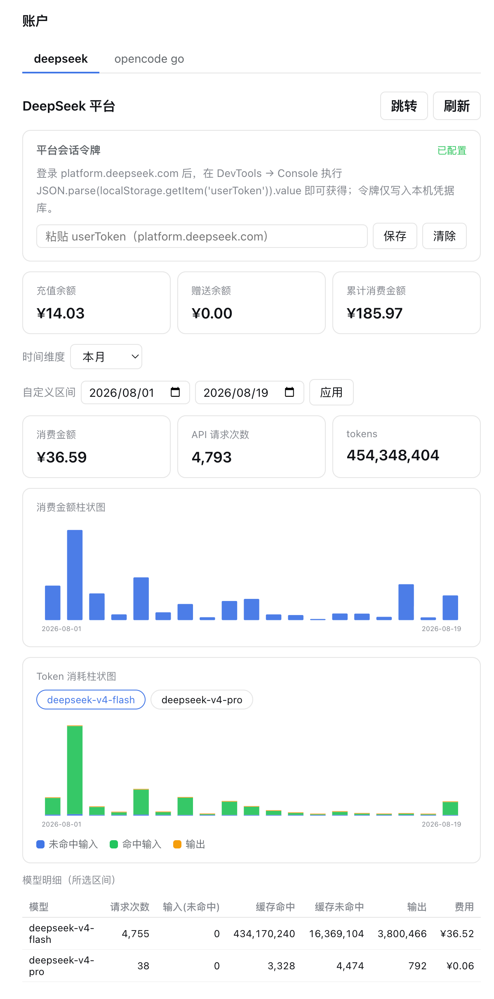
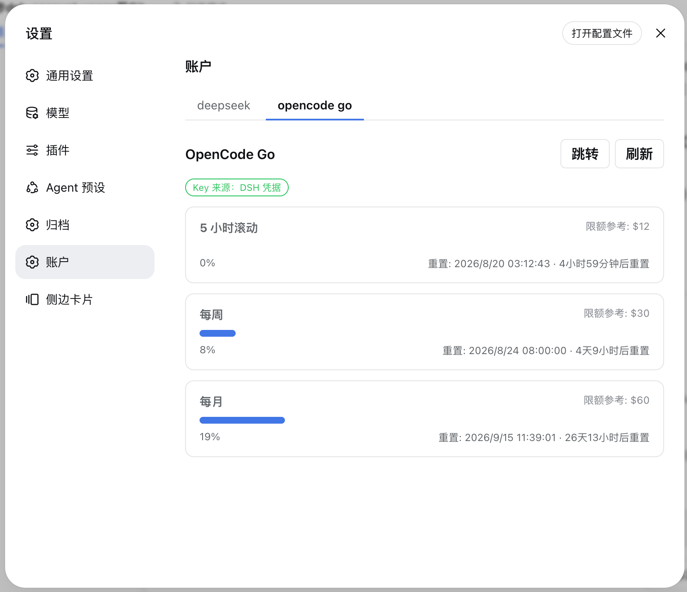

# dsh-account-usage

[](README.md)
[](README_en.md)

<div align="center">

A DeepSeek Harness (DSH) web-GUI plugin: adds an "Account" page to the settings panel for a one-stop view of DeepSeek platform balance/usage and OpenCode Go quotas.

[](LICENSE)
[](package.json)
[](https://github.com/deepseek-ai/deepseek-harness)

</div>

---

## 📑 Table of Contents

- [📸 Preview](#-preview)
- [✨ Features](#-features)
- [🚀 Quick Start](#-quick-start)
- [⚙️ Configuration](#️-configuration)
- [📖 Usage](#-usage)
- [🔧 How It Works](#-how-it-works)
- [🧰 Environment Variables](#-environment-variables)
- [⚠️ Known Limitations](#️-known-limitations)
- [🛠️ Development](#️-development)
- [🤝 Contributing](#-contributing)
- [📄 License](#-license)

---

## 📸 Preview

**DeepSeek platform content** (embedded below the native cards of the official Account & balance page by default; the old screenshots show the standalone fallback layout): balance overview, time-range selector with custom range, daily cost/token bar charts, web search/fetch usage charts, per-model detail table.



**OpenCode Go tab**: usage progress bars, reset times and reference limits for the 5-hour rolling / weekly / monthly windows.



---

## ✨ Features

| Feature | Description |
|---------|-------------|
| **DeepSeek platform overview** | Recharge balance, bonus balance, cumulative spending, current-month spending and tokens |
| **Daily bar charts** | Cost and token consumption charts, SVG-rendered, with hover tooltips per day |
| **Web search / fetch usage** | Daily call counts and cost by call type (`tool-search` / `tool-fetch`) with per-tool area charts, following the selected range; ranges over 31 days are queried in windows and merged |
| **Merge into the official Account & balance page** | When the official page exists, plugin content is embedded below its native cards and no separate nav entry is added; switching sections hides it and switching back restores it |
| **Account-menu balance entry** | Shows "Balance: ¥x.xx" (top-up + granted) above "Settings" in the account menu; click to open the official Account & balance page, falling back to the plugin's own page when the official one is unavailable |
| **Time-range switching** | Today / last 7 days / last 30 days / last 90 days / this month / last month / custom range |
| **Per-model table** | deepseek-v4-flash / deepseek-v4-pro / others: request count, input/cached/output tokens, cost |
| **OpenCode Go quotas** | Usage percentage and next reset time for the 5-hour rolling / weekly / monthly windows |
| **Auto refresh** | Polls for fresh data every 60 seconds while the page is mounted |
| **Bilingual UI** | Full Chinese/English switching |
| **Fallback standalone page** | When DSH is signed out or the official account page does not exist, the plugin registers its own "Account" section so the token and usage stay reachable |

> [!NOTE]
> `0.3.0` merges the plugin content into the official "Account & balance" page: when that page exists, no separate "Account" nav entry is shown and the content appears below the native cards; embedded mode keeps the full "top-up / granted / cumulative spend" balance display alongside the official balance card (the two may refresh at slightly different times). The account-menu balance entry now opens the official page. The standalone fallback page remains for signed-out users / older DSH. Fully quit and reopen DSH desktop after upgrading.

> `0.2.0` adds web search/fetch usage charts and an account-menu balance entry. The entry targets the native account menu structure of DSH desktop `0.2.1-rc.5`: on older versions without that menu, or if upstream redesigns it, the entry stays hidden without affecting the Account page. The tool-usage API is limited to 31 days per request; the plugin splits and merges longer ranges automatically. Fully quit and reopen DSH desktop after upgrading.

---

## 🚀 Quick Start

### Prerequisites

- DSH CLI and pnpm installed (`dsh plugin` forwards to pnpm internally)

### Install

```sh
# Option 1: install from a local source directory (development)
dsh plugin --profile web add <absolute-path-to-plugin>

# Option 2: install from GitHub
dsh plugin --profile web add github:Ycet/dsh-account-usage
```

The package declares a `dsh.bundle` patch layer; `dsh plugin` merges the loader entry into the profile's bundle layer automatically — no manual editing of `cordis.patch.yml` required.

<details>
<summary>Manual patch-layer merge (optional)</summary>

```yaml
# ~/.dsh/profiles/web/cordis.patch.yml
- insert:
    - id: account-usage
      name: dsh-account-usage
```
</details>

### Launch

1. Restart the web app: `dsh web`
2. Open http://127.0.0.1:3080 and refresh the page
3. After signing in to a DSH official account, open "Settings → Account & balance"; the plugin content appears below the native cards. When signed out, the plugin's fallback "Account" page appears instead

---

## ⚙️ Configuration

### DeepSeek platform token (required; only affects the DeepSeek tab)

The usage endpoints are private APIs of the platform console and need your login token:

1. Sign in at https://platform.deepseek.com
2. Open DevTools → Console and run:

   ```js
   JSON.parse(localStorage.getItem('userToken')).value
   ```

3. Paste the token into the input on the plugin's "Account" page and save it (stored as `DEEPSEEK_PLATFORM_TOKEN` in `~/.dsh/.credentials.yaml`)

<details>
<summary>Write the credentials file manually (optional)</summary>

```yaml
# ~/.dsh/.credentials.yaml
DEEPSEEK_PLATFORM_TOKEN: <token>
```
</details>

The token stays in your local credential store; the browser and network requests never carry it anywhere beyond the upstream.

### OpenCode Go key (usually no configuration needed)

The plugin looks it up automatically in this order:

1. DSH credential `OPENCODE_GO_API_KEY` (`~/.dsh/.credentials.yaml`; usually already present when opencode-go is configured in Settings → Models);
2. OpenCode's own `~/.local/share/opencode/auth.json` (the `opencode-go` entry with `type: api`).

---

## 📖 Usage

- Open the official "Account & balance" page in settings; the plugin content appears below the native identity/balance cards. When signed out, the plugin's standalone "Account" page is shown instead;
- Switch between the **deepseek / opencode go** tabs at the top of the embedded plugin content;
- On the DeepSeek tab, pick a time range (Today / last 7 days / last 30 days / last 90 days / this month / last month) or choose a custom range and click "Apply";
- Hover over the bar charts for daily details; the per-model table shows requests, tokens and cost for the selected range;
- The "Web Search & Fetch" module shows daily `tool-search` / `tool-fetch` call counts, call-type cost and per-tool area charts for the selected range; ranges over 31 days are split and merged automatically;
- The account menu (sidebar account avatar) gets a "Balance: ¥x.xx" entry above "Settings" (top-up + granted balance); clicking it opens Settings on the official "Account & balance" page (or the fallback page when the official one is unavailable);
- On the OpenCode Go tab, view usage percentage, next reset time and reference limit for each quota window, with one-click "Go to opencode.ai" and "Refresh" buttons;
- Data auto-refreshes every 60 seconds while the page is mounted; "Open config file" locates your local DSH credentials file.

---

## 🔧 How It Works

A dual-half plugin (host + browser) with data flowing through same-origin HTTP routes registered by the host:

| Part | File | Role |
|------|------|------|
| Host | `index.js` | Registers three precise `GET /api/account-usage/*` routes (`deepseek-summary` / `deepseek-usage` / `opencode`); resolves keys via `ctx.credentials`, uses a fixed allow-listed upstream URL, 15s timeout + 30s cache; `deepseek-usage` merges model usage with web search/fetch usage |
| Parsing/aggregation | `lib/aggregate.js` | Pure functions: daily/per-model token, cost and request-count aggregation; time-window splitting and function-usage merge for web search/fetch |
| Browser | `client.js` | Hand-written lazy CJS client bundle: when the official account page exists, mounts its content root below the native cards of its `settings.section` `<section>` using `react-dom/client` (detaches DOM but keeps the root on section switches; unmounts when settings closes); otherwise registers the fallback `settings.section` (id `account-usage`). Also renders the SVG charts, 60s refresh, settings nav icon and account-menu balance entry |
| Composition | `cordis.patch.yml` | `dsh.bundle` patch layer, merged automatically on install |

### Data sources

| Purpose | Endpoint | Auth |
|---------|----------|------|
| Account summary | `platform.deepseek.com/api/v0/users/get_user_summary` (+`/get_user_info`) | `Bearer <userToken>` |
| Daily token details | `platform.deepseek.com/api/v0/usage/amount?month=&year=` | `Bearer <userToken>` |
| Daily cost details | `platform.deepseek.com/api/v0/usage/cost?month=&year=` | `Bearer <userToken>` |
| Web search/fetch call counts | `platform.deepseek.com/api/v0/usage/by_api_key/amount?start=&end=&tz=` (≤31 days per request) | `Bearer <userToken>` |
| Web search/fetch cost | `platform.deepseek.com/api/v0/usage/by_api_key/cost?start=&end=&tz=` (≤31 days per request) | `Bearer <userToken>` |
| OpenCode Go quota | `opencode.ai/zen/go/v1/usage` (official) | `Bearer <sk-opencode-…>` |

---

## 🧰 Environment Variables

| Variable | Default | Description |
|----------|---------|-------------|
| `DSH_ACCOUNT_USAGE_TIMEOUT_MS` | `15000` | Upstream request timeout (ms) |
| `DSH_ACCOUNT_USAGE_CACHE_MS` | `30000` | Platform data cache TTL (ms) |
| `DSH_ACCOUNT_USAGE_MAX_MONTHS` | `3` | Max months a single query may span (truncated automatically) |
| `DSH_ACCOUNT_USAGE_OPENCODE_CACHE_MS` | `60000` | OpenCode quota cache TTL (ms) |

---

## ⚠️ Known Limitations

- The DeepSeek usage APIs are **undocumented private endpoints**; fields may change as the platform evolves. The plugin parses responses defensively and degrades missing fields to "—" instead of failing. If "—" persists, re-capture the API and report back.
- "Cumulative spending" and "API request count" are not in public docs: cumulative spending is located by a naming heuristic in the summary response (shows "—" if not found), and request count reads `count/requests/request_count/req_count/calls` fields on model entries. Both were calibrated against a real token.
- The web search/fetch usage API accepts at most 31 days per request; the plugin splits longer ranges into 31-day windows, so very long ranges make more requests. Tool names come from the platform's `functions` array (`tool-search` / `tool-fetch` today); unknown tools are shown as-is.
- The account-menu balance entry relies on the native DSH 0.2.x account menu DOM. If upstream redesigns that menu, the entry may be temporarily hidden, without affecting the account page or other features. It only reads the platform token already configured for this plugin and stores no balance data.
- The merged content relies on the official "Account & balance" page DOM (the `<section>` inside `[data-slot="settings.section"]`). If upstream rewrites that page, the embedded content may stop appearing; the fallback page is not shown while the official page exists.
- Within one settings session, switching sections preserves the embedded tab/time range; closing and reopening settings resets them to deepseek / this month. The official page only exists when signed in to a DSH official account; signed-out users get the fallback page.
- OpenCode Go limits ($12/$30/$60) are reference values for the plans; the endpoint does not return limits. Check opencode.ai when plans change.
- When bound to `0.0.0.0`, this plugin's routes are reachable on the LAN (the same pre-existing limitation as other local DSH plugins; the default `127.0.0.1` is unaffected).

---

## 🛠️ Development

```sh
npm run check  # host, client and aggregation syntax checks
npm test       # credential and OpenCode Go response regression tests

# Local install (development iteration):
dsh plugin --profile web add <absolute-path-to-plugin>
# After changing the source, reinstall (remove then add, or bump the version and add again), then restart dsh web
```

After modifying `client.js`, restart `dsh web` (the boot-graph hash is regenerated) and hard-refresh the page.

For the desktop app, quit it completely and reopen it. A local `link:` installation loads the updated source directly. Set `DSH_TEST_INSTALL_ROOT` to a DSH runtime directory containing `node_modules` to also test both loading orders of the built-in and plugin pages using the real slot registry, plus removal of the plugin page while retaining the built-in page. Without this variable, these two integration tests are skipped.

> [!NOTE]
> On Windows, `dsh plugin` forwards to pnpm through the shell, so the install path must not contain spaces; if your workspace path has spaces, create a junction (`mklink /J`) in a space-free path as an install gateway.

---

## 🤝 Contributing

Issues and pull requests are welcome: report problems with a screenshot and the plugin version at [Issues](https://github.com/Ycet/dsh-account-usage/issues); for improvements, follow Fork → branch → PR.

---

## 📄 License

This project is licensed under the [MIT](LICENSE) license.
